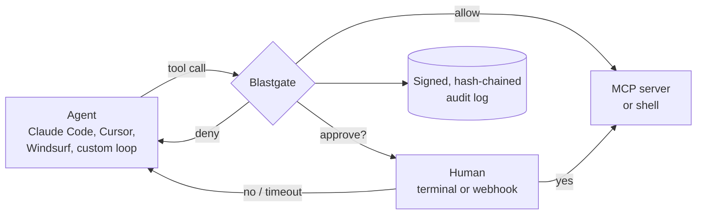

# Blastgate

**Deterministic policy firewall and approval gate for MCP servers and autonomous CLI agents.**

Blastgate sits in the critical path of every tool call your agent makes. It checks each call against plain YAML rules *before* it runs, pauses risky ones for a human, and writes a hash-chained, Ed25519-signed audit log of every decision. No model in the loop, no network calls, zero dependencies.

```bash
npx blastgate demo
```



[](https://github.com/bzucker4/blastgate/actions/workflows/ci.yml)
[](https://www.npmjs.com/package/blastgate)
[](LICENSE)


---

## Why

Background agents now run shell commands, edit files, call APIs and hit databases while nobody is watching. One bad loop or one prompt injection can `DROP TABLE`, `rm -rf`, leak a key, or burn your API budget. Manual review does not scale, coarse permissions are all-or-nothing, and logs only tell you what already happened.

Blastgate answers one question for every action, in microseconds, the same way every time: **allow, deny, or ask a human?**

## What it blocks out of the box

The built-in `default` policy (used when you have no config) covers:

| Rule | What it does |
| --- | --- |
| `no-destructive-sql` | Denies `DROP`, `TRUNCATE`, `ALTER ... DROP`, `GRANT/REVOKE`, and `DELETE`/`UPDATE` without `WHERE`, in any tool argument. Ignores keywords inside string literals and comments. |
| `approve-destructive-shell` | Asks before `rm -rf`, `mkfs`, `dd of=/dev/...`, force pushes, `git reset --hard`, `terraform destroy`, `kubectl delete`, `curl \| sh`. Sees through `&&`, `;`, pipes, `$(...)`, backticks, `sudo`, `env`, `nohup`. |
| `no-secret-files` | Denies reads and writes of `~/.ssh`, `~/.aws`, `~/.kube`, `.env` files and friends, including via `cat` in a shell. |
| `writes-stay-in-project` | Asks before any file write outside the working directory or `/tmp`. Resolves `..` and symlinks. |
| `no-exfil-endpoints` | Denies calls to common data drop and tunnel hosts (ngrok, webhook.site, pastebin, ...). |
| `approve-production` | Asks before anything on an MCP server whose name contains `prod`. |
| `approve-side-effects` | Asks before webhooks, emails, messages, deploys, publishes and payments. |
| `loop-guard` | Denies the 6th identical call within 60 seconds (runaway loops). |
| `rate-cap` | Denies past 120 calls per minute. |

## Architecture



```
agent ──tool call──▶ blastgate ──allow──▶ MCP server / shell
                       │  │
                deny ◀─┘  └─approve─▶ human (tty / webhook) ── yes ──▶ run
                       │                                     └─ no/timeout ──▶ deny
                       └──▶ .blastgate/audit.jsonl  (sha256 chain + ed25519)
```

Three ways in, one engine:

1. **MCP proxy** `blastgate mcp -- <server>`: transparent stdio proxy. Only `tools/call` is inspected; everything else passes through byte for byte. Denied calls come back to the agent as a normal tool result with `isError: true` and the reason, so the agent adapts instead of crashing.
2. **Shell guard** `blastgate exec -- <cmd>`: checks a command, strips secret env vars, enforces a timeout, passes the exit code through.
3. **Claude Code hook** `blastgate hook claude-code`: a `PreToolUse` hook that covers built-in tools (Bash, Write, Edit, WebFetch) and MCP tools. Approvals use Claude Code's own prompt.

Decision precedence is fixed and never depends on rule order: **any deny wins, then approve, then allow, then the policy default.**

## Install

```bash
npx blastgate demo          # try it, nothing installed
npm i -g blastgate          # or install the CLI
blastgate init              # writes ./blastgate.yaml with the default rules
blastgate lint              # validate it
```

Node.js 18+. No other dependencies, no daemon, no account.

## Copy-paste configs

Wrap any stdio MCP server by putting `npx -y blastgate mcp --name <name> --` in front of its command.

### Claude Code

Fastest: install the plugin. It adds the `PreToolUse` hook that checks every tool call, built-in and MCP, against `./blastgate.yaml` or the default policy:

```
/plugin install blastgate --marketplace bzucker4/blastgate
```

Or from a terminal: `claude plugin install blastgate --marketplace bzucker4/blastgate`. Needs Claude Code 2.1.275 or later. To try it without blocking anything first, start Claude Code with `BLASTGATE_MODE=shadow`.

To wire it up by hand instead, or to add the MCP proxy layer as well:

MCP server (`.mcp.json` in your project, or `claude mcp add`):

```json
{
  "mcpServers": {
    "postgres": {
      "command": "npx",
      "args": ["-y", "blastgate", "mcp", "--name", "postgres", "--",
               "npx", "-y", "@modelcontextprotocol/server-postgres", "postgresql://localhost/mydb"]
    }
  }
}
```

Guard built-in tools too (Bash, Write, Edit, WebFetch) with a hook in `.claude/settings.json`:

```json
{
  "hooks": {
    "PreToolUse": [
      {
        "matcher": "*",
        "hooks": [{ "type": "command", "command": "npx -y blastgate hook claude-code" }]
      }
    ]
  }
}
```

### Cursor

`~/.cursor/mcp.json` or `.cursor/mcp.json`:

```json
{
  "mcpServers": {
    "filesystem": {
      "command": "npx",
      "args": ["-y", "blastgate", "mcp", "--name", "filesystem", "--",
               "npx", "-y", "@modelcontextprotocol/server-filesystem", "./"]
    }
  }
}
```

### Windsurf

`~/.codeium/windsurf/mcp_config.json`:

```json
{
  "mcpServers": {
    "github": {
      "command": "npx",
      "args": ["-y", "blastgate", "mcp", "--name", "github", "--",
               "npx", "-y", "@modelcontextprotocol/server-github"],
      "env": { "GITHUB_PERSONAL_ACCESS_TOKEN": "<your token>" }
    }
  }
}
```

### Claude Desktop

`claude_desktop_config.json`: same shape as Cursor. Note that GUI clients have no terminal, so set `approval.channel` to `webhook` or `auto-deny` (a `tty` approval with no terminal is denied, never silently allowed).

More in [docs/integrations.md](docs/integrations.md).

## Writing policies

```yaml
version: 1
name: my-project
default: allow              # allow | deny | approve

approval:
  channel: tty              # tty | webhook | auto-deny | auto-approve
  timeout_seconds: 120      # no answer = deny

rules:
  - id: no-destructive-sql
    action: deny
    match:
      sql: destructive
    message: Add a WHERE clause or ask the user.

  - id: github-read-only
    action: deny
    match:
      server: github
      tool: ["create_*", "delete_*", "merge_*", "push_*", "update_*"]

  - id: egress-allowlist
    action: deny
    match:
      domain_not_in: ["api.github.com", "*.anthropic.com", "registry.npmjs.org"]

  - id: jail
    action: deny
    match:
      kind: fs
      path_outside: ["./src", "./tests", "/tmp"]

  - id: no-publish
    action: approve
    match:
      kind: shell
      command: ["npm publish*", "git push*main*"]

  - id: loop-guard
    action: deny
    match: { tool: "*" }
    limit: { max: 5, per_seconds: 60, same_args: true }
```

Matchers: `kind`, `tool`, `server`, `command` (globs), `shell: destructive`, `sql: destructive`, `args` (regex per argument path), `any_arg` (regex over every string argument), `path_outside`, `path_inside`, `domain_not_in`, `domain_in`, plus `limit` for rate caps. All conditions in one rule must hold. Full reference: [docs/policy.md](docs/policy.md).

Test a policy from CI without running anything:

```bash
blastgate check '{"kind":"shell","command":"git push --force"}'   # exit 2 = needs approval
blastgate check '{"kind":"mcp","tool":"query","args":{"sql":"DROP TABLE t"}}'   # exit 1 = deny
```

### Try a policy in shadow mode first

Shadow mode runs the full policy and logs every decision, but blocks nothing and never asks for approval. Install Blastgate in front of a real agent, let it work for a day, then read what it *would* have stopped before you turn enforcement on.

```bash
blastgate mcp --shadow -- npx -y @modelcontextprotocol/server-postgres "$DATABASE_URL"
blastgate audit tail          # ALLOW  postgres/query (shadow: would deny) [no-destructive-sql]
```

Use `--shadow` on `mcp`, `exec` or `hook claude-code`, set `mode: shadow` in the policy file, or set `BLASTGATE_MODE=shadow`. `--shadow` wins over the env var, which wins over the file, so `BLASTGATE_MODE=enforce` switches a shadow policy back on. Errors still fail closed: a policy that will not load, an invalid mode, or an internal error denies, even in shadow mode.

## Audit log

Every decision and every execution result is appended to `.blastgate/audit.jsonl`. Each line holds the SHA-256 of the line before it and an Ed25519 signature from a key created on first use in `~/.blastgate/keys/` (0600). Argument values under keys that look like secrets (`password`, `token`, `api_key`, ...) are redacted, and long strings are truncated.

When you run both the Claude Code hook and the MCP proxy, an MCP call is checked twice, once by each layer, and both decisions are kept in the log. Both entries carry Claude Code's `tool_use_id`, and `audit tail` shows the call once, marked `via hook+proxy`, with the stricter of the two results.

```bash
blastgate audit tail            # recent decisions
blastgate audit verify          # chain intact? every signature valid?
blastgate audit head            # latest seq + hash, to anchor somewhere the agent cannot write
```

Editing, deleting or reordering any line breaks verification from that point. Truncating the tail is only detectable against a hash you anchored elsewhere, which is what `audit head` is for. See [docs/threat-model.md](docs/threat-model.md).

## How it compares

| | Blastgate | Agent built-in permission prompts | Container sandbox | Cloud IAM |
| --- | --- | --- | --- | --- |
| Understands MCP tool calls | Yes | Yes | No | No |
| Inspects arguments (SQL, paths, URLs inside a call) | Yes | Mostly by tool name or command prefix | No | No |
| Sees `rm -rf` hidden in `a && b`, `$(...)`, `sudo` | Yes | Varies | Contains the damage, does not prevent it | No |
| Per-call human approval with timeout = deny | Yes | Yes, interactive only | No | No |
| Webhook approvals for headless agents | Yes | No | No | No |
| Rate caps and runaway-loop guard | Yes | No | No | Partly (API quotas) |
| Tamper-evident signed audit trail | Yes | No | No | Yes (provider logs) |
| Same rules across Claude Code, Cursor, Windsurf, scripts | Yes | No, per tool | Yes | Yes |
| Setup | One `npx` line | Built in | Image + mounts | Org-level |
| Added latency per call | ~0.7 ms p50 through the MCP proxy, ~10 us p50 to evaluate | None | Container start per session | None |

Blastgate is a policy gate, not a kernel sandbox. It is strongest paired with one: the container limits what *can* happen, Blastgate decides what *should*.

### Benchmarks

`npm run bench` on Node 22, Linux, Xeon 2.1 GHz:

```
policy evaluation (default policy, 7 rules, 20000 calls): p50 9.8 us, p99 548.3 us
MCP round trip, direct      (1000 calls): p50 0.050 ms, p99 0.348 ms
MCP round trip, via proxy   (1000 calls): p50 0.715 ms, p99 3.563 ms  (includes signed audit write per call)
```

Most of the proxy overhead is the synchronous, locked, signed audit append. Your numbers will differ; run the bench.

## Use it as a library

```js
import { loadPolicy, Gate } from 'blastgate';

const gate = new Gate(loadPolicy('./blastgate.yaml'));
const { allowed, result } = await gate.check({ kind: 'shell', command: 'rm -rf /' });
if (!allowed) throw new Error(result.reason);
```

## Principles

- **Deterministic.** No LLM judge in the decision path. Same action + same policy = same answer.
- **Fail closed.** Bad policy, no terminal, webhook down, timeout, internal error: deny.
- **Boring config.** A YAML subset with no anchors or block scalars, strict validation, unknown keys are errors.
- **Zero dependencies.** Read every line in an afternoon. `src/` is about 1,700 lines.
- **Auditable from day one.** Signed logs are in the free tier, not an upsell.

## Roadmap

See [open issues](https://github.com/bzucker4/blastgate/issues?q=is%3Aissue+label%3Aroadmap). Next up: Streamable HTTP MCP transport, Cursor hooks adapter, `blastgate test` policy test files, spend caps from token usage, a JSON Schema for editor autocomplete.

## License

Blastgate is open source under the [GNU AGPL-3.0](LICENSE). Use it free for local development, CI and internal use.

### Commercial License & Enterprise

If you embed Blastgate in a proprietary product, offer it as part of a hosted or multi-tenant service, or cannot meet AGPL obligations, buy a commercial license. It also unlocks:

- Centralized policy sync with RBAC across teams
- Compliance exports (SOC 2, HIPAA evidence packs)
- Multi-tenant policy management and SSO
- Slack approvals with escalation
- Legal indemnity and priority support

**[Buy a commercial license](https://buy.polar.sh/polar_cl_pOeAF8Wkt8KHlWjNHZKAHe4BNiAhW3548PLsh0ivt8D)** or read [COMMERCIAL.md](COMMERCIAL.md). Run `blastgate license` for the short version.

## Sponsors

Blastgate is built by one maintainer. If it saved you from a bad day, [sponsor it](https://github.com/sponsors/bzucker4).

<!-- sponsor logos go here -->

## Contributing

Issues and PRs welcome. Contributors sign a short [CLA](CLA.md) (a bot will ask on your first PR) so the project can stay dual-licensed. See [CONTRIBUTING.md](CONTRIBUTING.md).

Found a bypass? Please report it privately: [SECURITY.md](SECURITY.md).
